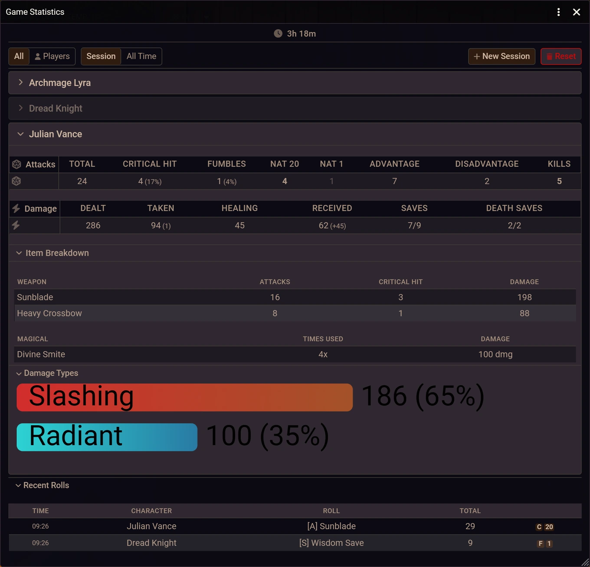

# Showstopper

A Foundry VTT v14 module for combat animations, blood trails, 2.5D token movement, status shaders, player portraits, and roll statistics.


## What it does

### Combat & Blood
Attacks get melee hit/miss/block animations, ranged recoil and projectiles, spell effects tinted by damage type, crit bursts, letterbox bars, scene dimming, and optional camera panning. Damage, healing, and temp HP pop up as arcing numbers colored by type.

The blood system adds directional hit splatters, death pools, footprints, creature-type blood colors, and bloodied token overlays. Stains dry over time or wash away in rain, and GMs also get a canvas brush and eraser for manual trails.

### Movement & Elevation


Tokens get grounded step bounce, jump arcs, hovering flight animations, and landing impacts after a fall (each client can toggle these individually). Elevated tokens scale with height, cast ground shadows, shift with parallax, optionally blur by depth, and can auto-zoom the camera out when selected.

### Token Shaders


Includes 7 WebGL/GLSL token shaders: `frozen`, `petrified`, `burning`, `corrupted`, `gilded`, `bloodrage`, and `glitch`. They apply automatically from active conditions or can be triggered from macros.

### UI & Table Tools
- **Portrait panel**: on-screen player avatars with voice activity, mute/AFK badges, quick context actions, and an optional ping/FPS readout.
- **Drag preview**: grid-snapped token preview when dragging actors from the sidebar, compendiums, or portrait panel (hold `Shift` to ignore the grid, `Alt` for a ghost preview).
- **Vignettes, camera & inventory**: screen-edge vignettes for low HP, conditions, and heal/damage flashes; smooth camera pan and zoom; item gain/loss toasts and rarity highlights on sheets and tooltips.

### Roll Statistics



Tracks both session and all-time stats: overview tables, per-character breakdowns for combat, survival, weapons, spells, and damage types, plus a recent rolls feed with search, player filtering, and chat export.

## Extensibility & API

If you want to hook into the module or add your own cut-ins (`introductions`, `openings`, `endings`, `finishers`), shaders, blood splatters, cinematic bars, or vignettes, the public API is exposed on `globalThis.showstopper` and `game.modules.get('showstopper').api`.

Configuration details, macro examples, and SDK docs live on the [Showstopper Wiki](https://github.com/SweetyHake/Showstopper/wiki).

## Installation

Install from **Setup -> Add-on Modules -> Install Module** using the manifest URL:

```text
https://github.com/SweetyHake/Showstopper/releases/latest/download/module.json
```

Or grab `showstopper.zip` from the [latest release](https://github.com/SweetyHake/Showstopper/releases/latest) and extract it into `<FoundryData>/Data/modules/showstopper`.

## Compatibility

Requires **Foundry VTT v14** (`socketlib` is not required).

Combat animations, flight speed detection, and roll tracking integrate directly with **D&D 5e (`dnd5e`)**. Everything else (shaders, portrait panel, smooth camera, vignettes, trail brush) works in any system. Optional integrations exist for **Sequencer**, **JB2A**, and **midi-qol**.

Available in English (`en`) and Russian (`ru`).

## License

Made by [SweetyHake](https://github.com/SweetyHake) · [Issues](https://github.com/SweetyHake/Showstopper/issues) · [Wiki](https://github.com/SweetyHake/Showstopper/wiki)

Proprietary personal-use license (All Rights Reserved). See [LICENSE](LICENSE).
