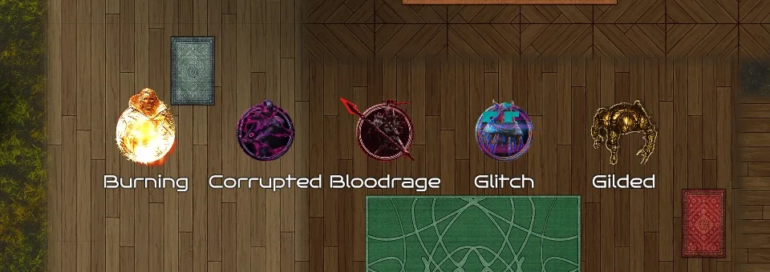

# Showstopper

Combat animations, dynamic blood, 2.5D token movement, WebGL status shaders, player portraits, and roll statistics for Foundry VTT v14.

[](https://foundryvtt.com/)
[](https://github.com/SweetyHake/Showstopper/releases/latest)
[](LICENSE)


## Features

### Combat & Blood
- **Combat Animations** — Melee hits, misses, and shield blocks, ranged recoil and projectiles, damage-typed spell attacks, critical hit effects, letterbox bars, scene dimming, and optional camera pan.
- **Combat Numbers** — Arcing damage, healing, and temporary HP popups colored by damage type.
- **Blood System & Trail Brush** — Directional hit splatters, death pools, footprints, creature-type blood colors, bloodied token overlays, drying and rain wash, plus a GM canvas brush and eraser.

### Token Movement & Vertical Display


- **Movement, Jump & Flight** — Grounded step bounce, arc jumps, mid-air flight and hover, and free-fall landing impacts, each toggleable per client.
- **Vertical Display** — Elevation scale, ground shadows, parallax, optional depth blur, and camera zoom-out when selecting elevated tokens.

### Token Status Shaders



- **7 GLSL Shaders** — `frozen`, `petrified`, `burning`, `corrupted`, `gilded`, `bloodrage`, and `glitch`, applied automatically from active token conditions or via script macros.

### Interface & Table Tools
- **Portrait Panel** — On-screen player avatars with voice activity, mute and AFK indicators, context actions, and an optional ping/FPS counter.
- **Token Drag Preview** — Grid-snapped token preview on the canvas when dragging actors from the sidebar, compendiums, or portrait panel (`Shift` to ignore grid, `Alt` for ghost preview).
- **Vignettes, Smooth Camera & Inventory+** — Screen-edge vignettes for low health, active conditions, and HP flashes; smooth camera pan and zoom; item gain/loss toasts and rarity highlights in sheets and tooltips.

### Game Statistics


- **Session & All-Time Stats** — **Overview** tables, per-character combat, survival, weapon, spell, and damage-type breakdowns, and a **Recent Rolls** feed with search, player filter, and chat export.

## Developer API

Showstopper exposes its public API at `globalThis.showstopper` (and `game.modules.get('showstopper').api`) for custom cut-ins (`introductions`, `openings`, `endings`, `finishers`), token shaders, blood effects, cinematic bars, and vignettes.

See the [Showstopper Wiki](https://github.com/SweetyHake/Showstopper/wiki) for configuration details, macro examples, and SDK documentation.

## Installation

Paste the manifest URL in **Setup -> Add-on Modules -> Install Module**:

```text
https://github.com/SweetyHake/Showstopper/releases/latest/download/module.json
```

Or extract `showstopper.zip` from the [Latest Release](https://github.com/SweetyHake/Showstopper/releases/latest) into `<FoundryData>/Data/modules/showstopper`.

## Compatibility

- **Foundry VTT**: v14 (`socketlib` not required).
- **Systems**: Built-in **D&D 5e (`dnd5e`)** hooks for combat animations, flight speed, and roll tracking; canvas shaders, portraits, camera, vignettes, and trail brush work in any system.
- **Optional Modules**: **Sequencer**, **JB2A**, **midi-qol**.
- **Languages**: English (`en`), Russian (`ru`).

## License

Created by **[SweetyHake](https://github.com/SweetyHake)** · [Issues](https://github.com/SweetyHake/Showstopper/issues) · [Wiki](https://github.com/SweetyHake/Showstopper/wiki)

Proprietary personal-use license (`All Rights Reserved`). See [LICENSE](LICENSE).
