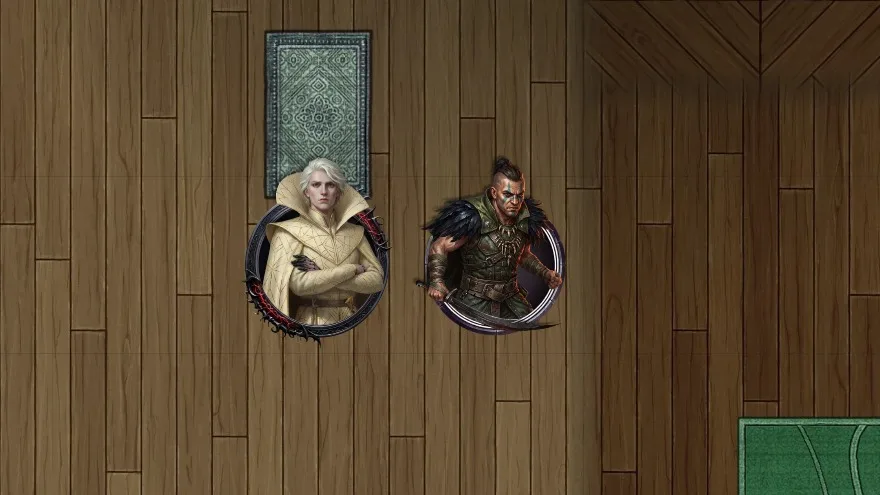
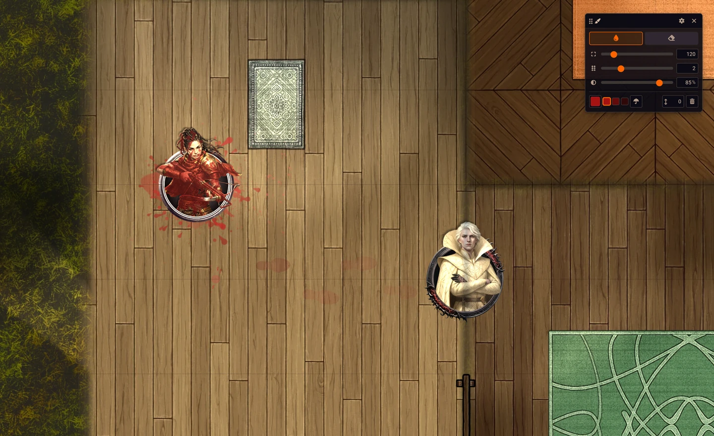
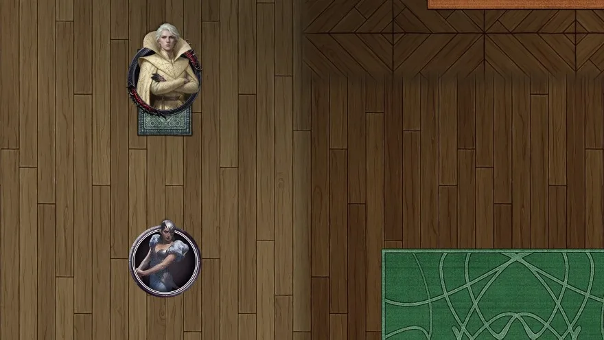
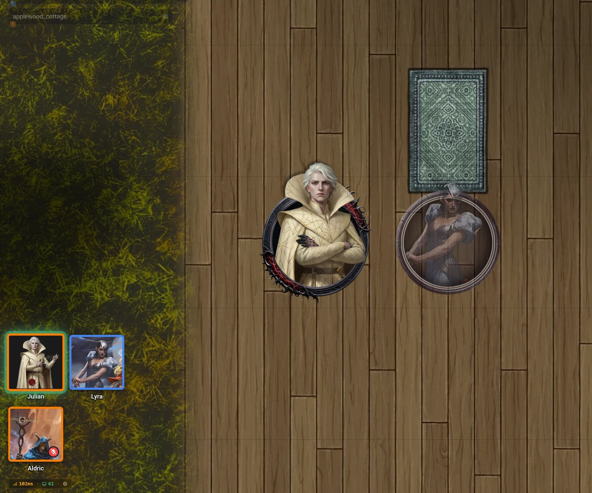
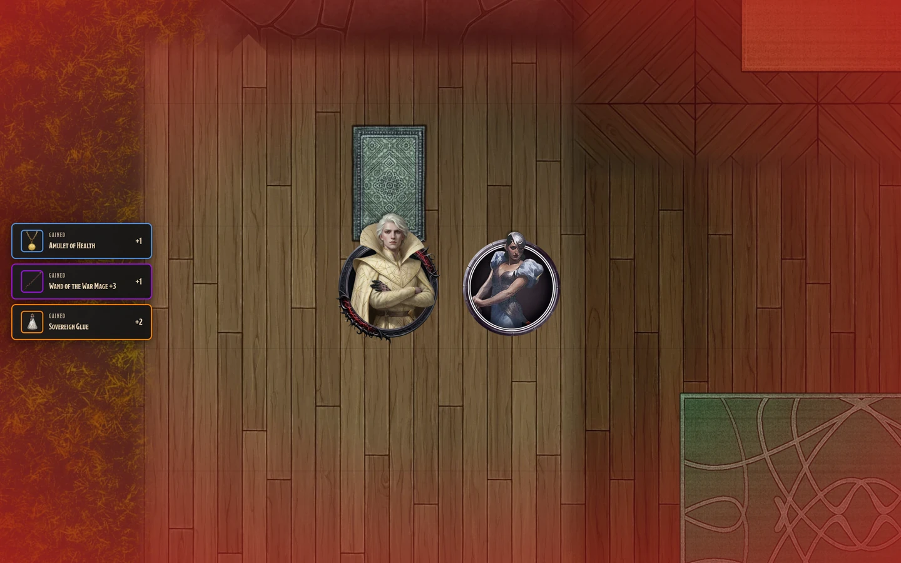

# Showstopper

Cinematic combat choreography, 2.5D token physics, dynamic blood & terrain trails, real-time GLSL token shaders, portrait overlays, and roll analytics for Foundry VTT v14+.

[](https://foundryvtt.com/)
[](https://github.com/SweetyHake/Showstopper/releases/latest)
[](LICENSE)



**Showstopper** brings your tabletop encounters to life with responsive attack animations, directional blood splatters, aerodynamic token flight, live WebGL status shaders, player portrait widgets, and detailed campaign roll statistics — synchronized across all connected clients over Foundry's native socket layer.

---

## Features

### Combat Choreography, Cinematic Bars & Floating Damage Numbers
- **Attack Choreography** — Automatic melee lunges, ranged recoils, hitstop freeze frames, target knockback, and subtle camera shake triggered on hits, misses, and critical strikes.
- **Cinematic Bars** — Smooth animated widescreen letterboxing (`showstopper.cinematicBars`) for dramatic reveals, boss entrances, and scripted scenes.
- **Floating Damage Numbers** — Arcing canvas popups styled by damage category and critical hits (`showstopper.damageNumbers`).
- **Sequencer & JB2A Support** — Optional integration with Sequencer and JB2A for crisp weapon slashes and impact flashes alongside core animations.

### Dynamic Blood, Bloodied Overlay & Trail Brush



- **Physics-Driven Blood Stains** — Directional splatters, arterial bursts, lingering pools, wall-clipped sprays, and bloody footprints painted directly onto the scene canvas.
- **Bloodied Token Overlay** — Dynamic blood coat shader applied automatically to wounded tokens as HP drops, supporting custom blood colors per actor or world.
- **Trail brush** — Dedicated GM canvas tool featuring Brush and Eraser modes, stamp presets, size/density/opacity controls, color swatches, elevation filtering (`Q`/`E`), and one-click cleanup.

### 2.5D Token Movement, Jump & Flight Physics



- **Fluid Movement Inertia** — Subtle walking cadence, sprint leaning, and smooth directional easing as tokens traverse the battlemap.
- **2.5D Jump Arcs** — Parabolic leap animations triggered automatically when ascending or stepping into mid-air elevations.
- **Aerial Flight Simulation** — Altitude-aware token scaling, aerodynamic banking on turns, gentle hover breathing idle, and dynamically offset ground shadows.

### Token Status Shaders


- **Real-Time PIXI/GLSL Shaders** — Transform any token visually on the canvas without duplicating actors or replacing artwork files.
- **7 Built-In Shader Effects** — Includes `frozen`, `petrified`, `burning`, `corrupted`, `gilded`, `bloodrage`, and `glitch`.
- **Clean Lifecycle** — Apply, toggle, or clear shaders cleanly via script macros or module integrations with automatic canvas teardown cleanup.

### Player Portrait Panel & Live Token Drag Preview



- **Player Portrait Panel** — Persistent party strip with active voice-speaking highlights, mute badges, subtle HP damage indicators, and a live network latency & FPS widget.
- **Live Token Drag Preview** — Renders full-scale pixel-accurate PIXI token previews (including dynamic Token Rings and wildcard artwork) snapped directly to the grid when dragging from the Portrait Panel, Actor Directory, or Compendiums. Hold `Shift` to place unsnapped or `Alt` for a translucent ghost preview.

### Screen Vignette, Smooth Camera & Inventory+ Notifications



- **Screen Vignette** — Multi-layered viewport vignette effects (`showstopper.vignette`) with customizable hex colors, intensity, radius, and fade timing.
- **Smooth Camera** — Fluid pan and zoom interpolation for seamless GM camera framing.
- **Inventory+ Notifications** — Compact rarity-colored toast alerts triggered automatically whenever characters receive, lose, or loot items.

### Session & Campaign Roll Statistics


- **Comprehensive Combat Analytics** — Tracks attacks, hits, critical hits, fumbles, natural 20s/1s, advantage/disadvantage usage, kills, damage dealt/taken, healing, saving throws, and death saves across **Session** and **All Time** scopes.
- **Item Breakdown & Charts** — Drill down per character into weapon usage, spells cast, skills, tools, and interactive **Damage Types** bar charts alongside a **Recent Rolls** feed.
- **GM Controls** — Filter by all combatants or player characters only, start fresh session counters, or reset tracked statistics on demand.

---

## Extensible Cinematic Framework & Developer API

Showstopper Core also ships a lightweight cinematic extension framework supporting four cut-in categories (`introductions`, `openings`, `endings`, and `finishers`), per-actor intro configuration, procedural Web Audio synthesis helpers, and unified canvas effect lifecycle tracking.

Core ships cleanly with **zero bundled cut-in presets** — register your own custom sequences or drive subsystems directly via `globalThis.showstopper` (also exposed at `game.modules.get('showstopper').api`):

```js
// Register a custom introduction sequence
showstopper.cutIns.register({
  id: 'custom-spotlight',
  category: 'introductions',
  icon: 'fas fa-star',
  async play(ctx) {
    // Custom cinematic camera, UI titles, and procedural synth choreography
  }
});

// Apply a GLSL status shader to a selected token
const token = canvas.tokens.controlled[0];
showstopper.finishers.shaders.apply(token, 'burning');

// Trigger directional blood splatters & a crimson screen vignette
showstopper.blood.splat(token, { impact: 1.0, dir: 0 });
await showstopper.vignette.show('#b91c1c', { layer: 'combat', intensity: 0.7, fadeIn: 300 });
```

See the [Showstopper Wiki](https://github.com/SweetyHake/Showstopper/wiki) for full configuration guides, macro examples, and extension SDK documentation.

---

## Installation

### Manifest URL (Recommended)
In Foundry VTT **Setup -> Add-on Modules -> Install Module**, paste the Manifest URL:

```text
https://github.com/SweetyHake/Showstopper/releases/latest/download/module.json
```

### Manual Installation
1. Download `showstopper.zip` from the [Latest Release](https://github.com/SweetyHake/Showstopper/releases/latest).
2. Extract its contents into `<FoundryData>/Data/modules/showstopper`.
3. Enable **Showstopper** inside your Foundry VTT v14 world.

---

## Compatibility & Languages

- **Foundry VTT**: Strictly **v14+** (`verified: "14"`). Uses Foundry's built-in `module.showstopper` socket channel (`socketlib` is **not** required).
- **Game Systems**: Deep integration for **D&D 5e (`dnd5e`)** attack/damage triggers, flight speed, and roll analytics, while core canvas effects, portraits, shaders, camera, and vignettes work system-agnostically.
- **Optional Modules**: **Sequencer** + **JB2A** (recommended for enhanced melee slash and hit VFX).
- **Languages**: Full **English (`en`)** and **Russian (`ru`)** localization.

---

## Author & License

Created by **[SweetyHake](https://github.com/SweetyHake)** · [Report Issues](https://github.com/SweetyHake/Showstopper/issues)

Distributed under a Proprietary Personal-Use License (`All Rights Reserved`). See [LICENSE](LICENSE) for full terms.
